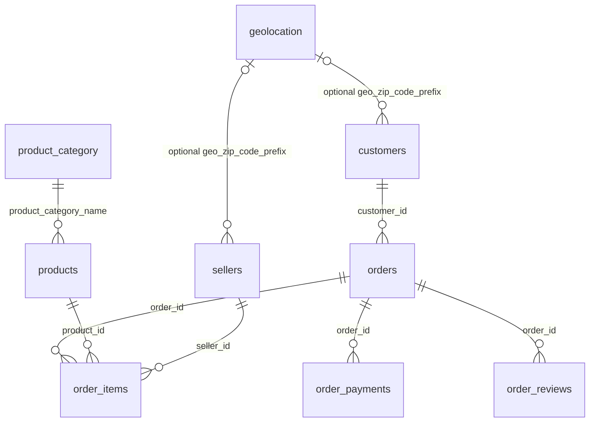

# 数据库设计

## 设计目标与粒度

数据库保留清洗后的 9 张源表，共 569,773 行。每张表的原始字段均保留。`customers` 中 `customer_id` 是订单关联用的客户记录标识，`customer_unique_id` 才是跨订单的真实客户标识。本快照两者的唯一性不能混用。

`order_items` 的粒度是订单中的一个商品条目，`order_payments` 是订单中的一次支付记录，`order_reviews` 是一条评价与订单的关联。它们都不能直接当作一行一个订单的事实表。

## 实体与联系

图中多重性表示模式允许的关系。本快照的 `customer_id` 与订单恰好一一对应，但没有把这个快照现象强加成通用业务唯一约束。

## 主键与外键

| 表 | 主键 | 外键 |
| --- | --- | --- |
| geolocation | zip_code_prefix | 无 |
| customers | customer_id | geo_zip_code_prefix → geolocation |
| sellers | seller_id | geo_zip_code_prefix → geolocation |
| product_category | product_category_name | 无 |
| products | product_id | product_category_name → product_category |
| orders | order_id | customer_id → customers |
| order_items | order_id + order_item_id | order_id → orders，product_id → products，seller_id → sellers |
| order_payments | order_id + payment_sequential | order_id → orders |
| order_reviews | review_id + order_id | order_id → orders |

9 个主键均经全量数据验证，无重复或缺失。源数据中有 814 条记录的 `review_id` 与此前记录重复，订单中也存在多条评价；因此评价表使用联合主键。

所有外键使用 `RESTRICT`，避免父记录被删除或改键时悄悄破坏数据。父表先导入，子表后导入；全程启用外键检查。

## 不完整的地理维度

原始清洗脚本明确保留了地理维度无法匹配的邮编。本次实测：

| 来源 | 无匹配记录 | 无匹配邮编种类 |
| --- | ---: | ---: |
| customers | 279 | 158 |
| sellers | 7 | 7 |

`customer_zip_code_prefix`、`seller_zip_code_prefix` 完整保留，均为 `CHAR(5)`。数据库各增加一个 `geo_zip_code_prefix CHAR(5) NULL`：如果邮编存在于地理表，则复制原邮编；否则设为 `NULL`。只有新增列建立外键。两列新增字段不写回 CSV。

这样保留所有源数据，同时由数据库真正执行可选联系的参照完整性。分析需使用 `LEFT JOIN geolocation ON ...geo_zip_code_prefix`，没有地理信息的记录会得到空坐标。

## 类型、约束与索引

- ID 使用 32 位 ASCII 字符串并区分大小写。邮编始终使用字符串。
- 所有表为 InnoDB，普通文本使用 utf8mb4，保留葡萄牙语重音及其他 Unicode 文本。
- 金额使用 DECIMAL(12,2)，不经二进制浮点转换；坐标、比例、时长和尺寸按 CSV 的 4 位小数精度保存。
- `order_estimated_delivery_date` 和 `purchase_date` 的源文件只有日期，因此使用 DATE；其他时间列使用 DATETIME。源文件没有时区声明，DATETIME 原样保存，不强行转换到新加坡或 UTC。
- 缺失审核、交付时间和相关时长允许 NULL。`is_late` 缺失表示未知，不能当作未迟到。空评价标题/正文保留空字符串，与源清洗脚本一致。
- 检查评分 1–5、标记 0/1、邮编/ID 输入格式、非负金额及分期数。商品合计等于价格加运费；评价长度和情感标签与源分数保持一致。
- 不给配送日期先后关系增加会拒绝历史异常记录的约束。源异常记录和异常标记保留。
- 主键/外键索引之外增加客户唯一身份、州、原邮编、购买时间、状态与月份、订单评价时间索引，覆盖下一步常见筛选和连接。

源 CSV 中保留了总订单数、购买年月、商品体积、价格合计、时长、情感标签等衍生字段。因此这是保留清洗快照的分析关系库；存在有意保留的函数依赖和冗余，不能将其称为完全规范化的第三范式事务系统。后续若要支持业务更新，需要单独定义衍生字段维护规则；当前分析账号只能读。

## 导入与失败恢复

导入前验证 SHA-256、字段、类型、主键、引用关系。使用参数化 `executemany`，能正确处理逗号、引号和 Unicode 文本，不启用 `LOCAL INFILE`。

建表 DDL 由 MySQL 自动提交；数据的 9 表导入放在同一个事务中，逐值校验通过后才提交。导入失败回滚所有数据行，可能留下空表，可修复原因后重跑。并发部署使用命名锁防止重复写入。

如果已存在任何数据，程序只执行完整校验；存在部分导入、手工修改或不同快照时停止，不自动清空。可以选择新的专用数据库名重新部署。

## 课件参考

提供的 SQL 课件用于参照 DDL、PRIMARY KEY、FOREIGN KEY、NOT NULL 与完整性约束；ER Design 课件用于实体到关系、键约束和联系映射；关系代数与演算课件用于选择、投影、连接与聚合查询的逻辑。课件中的示例和练习不作为本项目执行指令，也没有原样上传。

